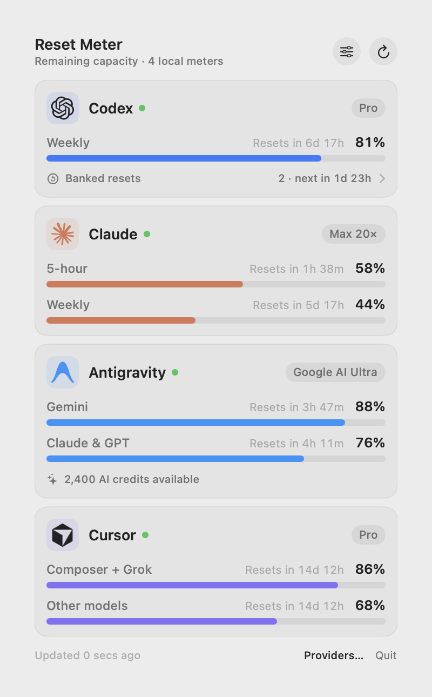

# Reset Meter

[](https://github.com/RZDESIGN/reset-meter/actions/workflows/ci.yml)

A lean, native macOS menu-bar meter for remaining usage in **Codex** (ChatGPT), **Claude**, **Antigravity**, and **Cursor** — read directly from your local installations with zero extra sign-ins.

Reset Meter keeps each provider's logo, a compact capacity bar, and the remaining percentage visible in the menu bar. A provider with multiple local clients or profiles shows its logo once, followed by one meter per account. Click the menu-bar item to inspect every usage window, reset countdown, subscription plan, and available credits or banked resets.

## Preview

<p align="center">
  
</p>

<p align="center">
  
</p>

The preview uses synthetic demo values generated by the app. It contains no account or desktop data.

## Install

Reset Meter supports macOS 14 or later on Apple Silicon and Intel Macs.

1. Download the latest DMG from [Releases](https://github.com/RZDESIGN/reset-meter/releases/latest).
2. Open it and drag **Reset Meter** to **Applications**.
3. Launch Reset Meter. It runs only in the menu bar, so it does not appear in the Dock.

The current community build is not Apple-notarized. On first launch, Control-click the app, choose **Open**, then confirm. A Developer ID-signed and notarized build can replace it without changing the app or installer scripts.

## Purely local, read-only tracking

Reset Meter does **not** ask you to sign in through a separate browser flow, does **not** write to macOS Keychain, and never rotates or invalidates your installed apps' tokens. Every card reads directly from the local installation on your Mac:

| Provider | Local source & behavior |
| --- | --- |
| **Codex** | Queries your installed `codex` CLI (`app-server`, including the CLI bundled inside `ChatGPT.app`) per `CODEX_HOME` directory for live rate limits, subscription plan, and banked resets. |
| **Claude** | Uses a 3-layer read-only pipeline per profile: **(1)** active local Claude Desktop Code session matched to that profile's organization or config directory, **(2)** standalone Claude Code credentials in macOS Keychain or `.credentials.json` (read-only, never rotated), and **(3)** Claude Desktop's `plan-usage-history.json` + `.claude.json` plan metadata when offline or idle. |
| **Antigravity** | Queries the running local Antigravity `language_server` over loopback (`127.0.0.1`) for live model quota pools (`Gemini`, `Claude & GPT`), subscription tier (for example **Google AI Ultra**), and available AI credits, with a local snapshot fallback while Antigravity is closed. |
| **Cursor** | Reads local `cursor-agent` CLI credentials (`~/.cursor/auth.json` / Keychain) or unencrypted `state.vscdb` automatically, and provides a one-click **Connect Cursor…** PKCE flow when Cursor 3.29+ encrypts its desktop token at rest (`cursor-safe-storage:v1:`). Tracks both `Composer + Grok` and `Other models` quota pools across Pro, Pro+, Ultra, Team, and Enterprise spend/pooled limits. |

These integrations use local or provider-internal interfaces rather than stable public usage APIs. A provider update can require a corresponding Reset Meter update.

## Multiple clients & local profiles

If you run separate Personal and Work installations side by side on the same Mac, Reset Meter discovers them automatically on launch and when you click **Scan Local Apps** in **Providers…**:

- **ChatGPT / Codex**: Automatically detects `~/.codex` alongside sibling profiles such as `~/.codex-work` (labeling them **Personal** and **Work**).
- **Claude**: Automatically detects `~/Library/Application Support/Claude` alongside isolated client data folders such as `~/Library/Application Support/Claude-Work`, pairing each with its matching `~/.claude` or `~/.claude-work` configuration directory (`CLAUDE_CONFIG_DIR`) and directory-scoped Keychain item.
- **Antigravity & Cursor**: Automatically hides uninstalled optional tools on first launch and discovers default or suffixed `Application Support` profiles.
- **Custom profile folders**: In **Providers…**, use **Add custom local profile** (**Browse…**) to point Reset Meter at any custom `CODEX_HOME`, Claude profile folder, or Cursor profile directory.

## Menu-bar styles, details, and visibility

- **Menu-bar display mode**: Choose **Bars & %**, **Bars Only**, or **% Only** in **Providers…** to fit smaller displays or MacBook notches cleanly, even with 5+ active meters.
- **Subscription plans**: Account cards display the provider-reported plan pill (such as **Pro**, **Business Pro Lite**, **Max 20×**, **Team**, or **Google AI Ultra**) when available, without clutter when omitted.
- **Codex banked resets & Antigravity AI credits**: Codex cards show available banked resets with expandable expiry countdowns; Antigravity cards surface available AI credits alongside model pool bars.
- **Live vs. cached indicator**: A green dot indicates a live reading; an orange dot indicates a cached reading when an app is closed or idle. Hover the dot to inspect the exact source.
- **Per-account visibility**: Toggle **Show** on any card in **Providers…** to hide or show individual accounts in the menu bar and popover without removing the profile.

## Privacy

- Usage requests go directly to each provider or its local loopback server (`127.0.0.1` for Antigravity, local `codex app-server` RPC for Codex, `api.anthropic.com` for Claude, and `api2.cursor.sh` for Cursor).
- Reset Meter operates strictly read-only against your local AI clients: it never writes to their databases, never mutates `.credentials.json` or Keychain items, and never triggers token-refresh races that could sign an app out.
- Local offline cache files under `~/Library/Application Support/Reset Meter/Usage Cache/` store only anonymized usage percentages, reset timestamps, and plan names — never tokens, emails, organization IDs, or file contents.
- Reset Meter does not read prompts, conversations, or repository contents, and has no analytics, telemetry, crash reporter, or update tracker.

Do not attach real usage files, access tokens, or unredacted screenshots to public bug reports.

## Build from source

Requirements:

- macOS 14 or later
- Xcode command-line tools with Swift 6

```sh
git clone https://github.com/RZDESIGN/reset-meter.git
cd reset-meter
swift test
./scripts/build-app.sh
```

The build script creates a universal (`arm64` + `x86_64`), ad-hoc-signed app at `dist/Reset Meter.app`.

Create a drag-to-Applications DMG:

```sh
./scripts/package-dmg.sh
```

## Signed releases

For Gatekeeper-trusted public distribution, export a Developer ID Application identity and a `notarytool` keychain profile:

```sh
export RESET_METER_SIGN_IDENTITY="Developer ID Application: Example (TEAMID)"
export RESET_METER_NOTARY_PROFILE="reset-meter-notary"
./scripts/package-dmg.sh
```

The script signs the universal app with the hardened runtime, signs the DMG, submits it to Apple's notary service, and staples the returned ticket.

## Project notes

- Provider discovery, parsing, and reset calculations live in `UsageMeterCore` and are covered by Swift Testing unit tests.
- The menu-bar label is rendered as one native template image because macOS does not reliably preserve nested SwiftUI views inside a `MenuBarExtra` label.
- Provider marks are used only to identify their respective services. See [Third-party notices](THIRD_PARTY_NOTICES.md).

## License

The source code is available under the [MIT License](LICENSE). Third-party names, marks, and artwork are excluded from that license.

Reset Meter is an independent community project. It is not affiliated with, sponsored by, or endorsed by OpenAI, Anthropic, Google, Cursor, or Apple.
